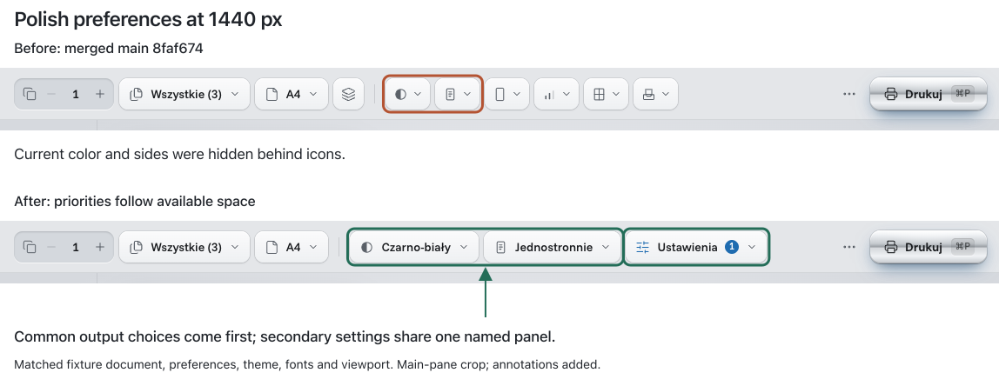
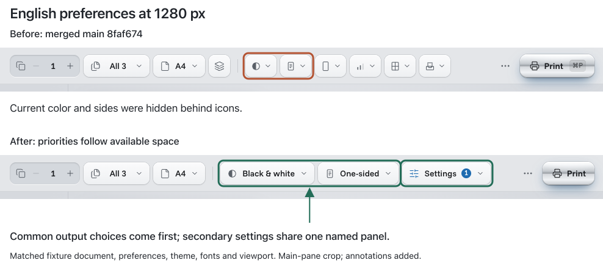
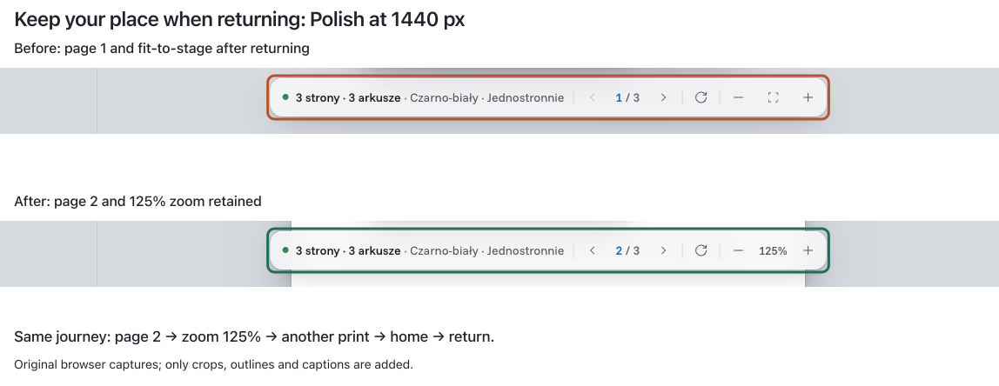

# Printing UX review

Baseline: merged `main` at `8faf674`, including PR #6. The screenshots use the same fixture document, print options, Cobalt palette, loaded Funnel fonts and viewport on both versions. The baseline source ran separately; its preview server was allowed to serve the existing font assets. The branch was not deployed.

## Exact changes

| Before | After | Why |
| --- | --- | --- |
| Fixed viewport thresholds hid values and folded color/sides early. | The toolbar measures its available space, prioritizes copies, pages, paper, color and sides, and groups secondary choices in Settings. It remeasures when content or fonts change. | Common output choices remain readable where they fit, including longer Polish labels. |
| Collapsed fields showed only a function name on hover; the previous tooltip could persist over an adjacent field. | Tooltips include selected values; a newly hovered field takes priority immediately after the first tooltip. Tooltip content remains hoverable. | Moving along the bar reveals the current settings without opening each menu. |
| Tooltip `data-state` masked the dropdown's open styling. | Open feedback uses `aria-expanded`; tooltips step aside while panels are open and while focus returns. | Open, hovered and selected states are distinct. |
| Leaving the document reset its preview. | The document stays mounted, hidden and inert while elsewhere; history, Archive and Settings offer a direct return. | Page, zoom and settings survive view changes; hidden shortcuts are inactive. |
| Old validation results could remain visible or keep a corrected document disabled. | Only a response for the current settings counts; the local sheet count remains visible while checking. | Feedback describes the settings actually in hand. |
| Rapid mouse-selection followed by Escape could leave an invisible modal layer blocking clicks. | Keyboard input reduces animation duration to zero while retaining the animation name, allowing Radix to finish dismissal. Folding waits for focus restoration. | Menus close reliably and keyboard focus remains usable. |
| Reduced-motion presses could remove the positioning wrapper's transform. | Press suppression targets buttons and links; chevrons snap under keyboard and reduced-motion input. | Panels stay under the pointer and remain operable. |
| The Polish page-range panel let its input and odd/even controls extend beyond the background. | The panel reserves space for the complete labels and constrains its grid and input to that width. | Range entry and all three page-set choices stay inside the panel. |
| At 900/861 px, status text pushed bottom zoom controls off-screen. | A container query places status on two compact lines before it can displace paging and zoom. | Every preview action remains visible and reachable. |

## Visual evidence

[Watch the Polish interaction recording](interaction-polish.mp4) — 1440 × 900, normal speed, approximately 16 seconds. Cursor and caption overlays are annotations; the app interactions are recorded directly. It exercises menus, nested selection and Escape, invalid/corrected page ranges, checking feedback, paging, zoom and return from history.

Original captures: [Polish before](before-toolbar-pl.png), [Polish after](after-toolbar-pl.png), [English before](before-toolbar-en.png), [English after](after-toolbar-en.png), [return action](after-return-pl.png), [continuity before](before-continuity-pl.png), [continuity after](after-continuity-pl.png). Outlines, arrows and captions are added only in the annotated figures. [Capture metadata](capture-metadata.json) records the source rectangles and font checks; [video metadata](video-metadata.json) records the chapters and final state.

Additional focused captures: [selected-value tooltip](tooltip-pl.png), [Polish page-range panel](page-range-pl.png).

## Verification

- `npm run check`: 52 tests pass, including translation coverage and folding/unfolding after labels shrink.
- `npm run build`: passes.
- Parent [browser matrix](browser-matrix.json): 28 desktop cases across English/Polish, light/dark, and 1920, 1440, 1280, 1200, 1100, 900 and 861 px. Toolbar bounds, preview-action bounds and center hit checks passed without horizontal page overflow.
- Eight touch-layout cases: English/Polish, light/dark, 390/360 px; settings sheets stayed within the viewport and visible buttons had accessible names.
- Four keyboard/reduced-motion cases passed. The reduced-motion pointer path retained the panel's positioning transform during a press.
- Twelve [page-range panel cases](page-range-check.json) passed: English/Polish at 1440, 900 and 861 px with fine/coarse pointers. Input, error, segmented controls and their labels stayed inside the panel; all/odd/even selection and invalid-to-valid range recovery worked.
- Focused parent [journeys](user-journeys.json) passed in both languages: history, Settings, Archive and Home return with page 2 at 125%; hidden `R` is inactive; a new file resets the preview. Additional checks covered Escape/Tab focus, open-panel resizing, nested selection, hover switching, and phone paper/driver controls and resume. The [tooltip handoff check](tooltip-check.json) also asserted one visible tooltip layer and hoverable content in both languages.
- Independent GPT-6.1 Terra at high effort found the narrow preview-bar defect, which was fixed and rechecked. It also verified Polish phone range recovery, defaults save/reset, the print payload, and queued → printing → printed fixture states, plus language switching and several desktop controls. Its [final report](terra-final-review.md) explicitly stopped short of blanket approval; the remaining targeted coverage was completed by the parent checks above.

The UI ran against intercepted in-memory API responses and fixture PDFs. No live account or printer data was changed. Physical output, real-device touch gestures, and Safari/Firefox were not verified.

## Motion review

**Approve for the changed interaction surface.** Pointer navigation uses a 140 ms fade; menus retain their trigger origins and existing 170/120 ms timing. Keyboard view/menu changes and chevrons are immediate. Reduced motion retains fades, removes press movement, and preserves popup positioning. Adjacent tooltip changes skip delay and animation. Existing motion outside this change was not audited exhaustively.
